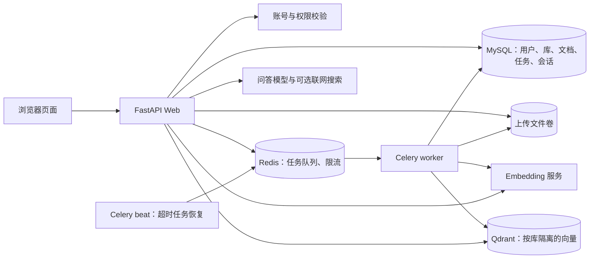

# 第十七阶段：产品化与项目展示

> [返回 README](../README.md) · [运行与部署](运行与部署.md) · [固定样本评测](../eval/README.md)

## 本阶段交付

- **中文页面**：知识库说明和资料计数更直观；上传显示传输进度与随后建立索引的状态；历史会话可按标题、知识库及类型搜索筛选，显示所属范围和更新时间；每条知识库回答可点击依据跳转至原文片段，可提取文字的 PDF 还显示页码。
- **错误提示**：页面将接口校验错误、文件过大、限流及网络失败转成可读提示。上传状态、失败重试和删除后的列表刷新继续使用已有接口，历史回答不会因删除资料而重写。
- **演示材料**：[`data/demo/星桥计划.md`](../data/demo/星桥计划.md) 和 [`data/demo/星桥团队.md`](../data/demo/星桥团队.md) 为完全虚构的最小演示数据，不含真实账号、组织、联系方式或密钥。
- **展示材料**：下文提供与当前代码和 Compose 服务一致的架构图、可操作的演示步骤、主要设计取舍、已保存的评测报告和可引用的项目描述。

## 一次完整演示

先按[运行与部署](运行与部署.md)准备 `.env.compose` 并启动服务。使用独立测试账号登录，在页面创建“星桥演示库”，用途说明可填“交付信息问答”。上传本阶段两份 Markdown，观察“正在上传”进度与“正在建立索引”，直到两份资料都显示“已索引”。

1. 提问“星桥计划的正式交付日期是什么？”，预期回答 **2027 年 4 月 18 日**，点击回答下方“依据 1：星桥计划.md”定位原文。
2. 继续问“它由谁负责？”，预期回答 **林澈**，来源应为“星桥团队.md”。刷新浏览器后，在历史会话中重新打开同一会话，核对两个回答和依据仍在。
3. 使用历史会话搜索框和“当前知识库”筛选，核对会话可定位。删除演示库中的“星桥团队.md”后，资料列表应只剩“星桥计划.md”；已有历史回答保留，新提问只依据当前已索引资料。

若尚未索引完成，等待页面状态更新后再提问。默认关闭的联网搜索按钮保持关闭，以免演示问题走网页来源。演示资料可直接在本地重新上传，删除仅针对演示账号的库内副本。

## 当前架构与数据流

上传请求先写文件与任务元数据；worker 解析、切分、向量化并写入 Qdrant，更新 MySQL 任务和文档状态。浏览器通过文档列表接口轮询状态。知识库提问先按本人和知识库范围检索已索引片段，经重排与证据审核后生成回答，完整轮次及依据写入 MySQL。联网搜索由用户显式开启，通过独立调用返回网页来源，不自动写入知识库。完整容器栈还包含一次性 Alembic 迁移任务；细节以 [`compose.yaml`](../compose.yaml) 和[运行与部署](运行与部署.md)为准。

## 设计取舍

| 决策 | 原因与边界 |
| --- | --- |
| MySQL 存元数据和会话，Qdrant 存向量，上传文件独立存储 | 保持归属、索引状态、原文和向量的职责清楚；删除时必须处理跨存储一致性，失败会留可重试状态。 |
| Redis + Celery 处理索引 | 上传不必等待解析和 Embedding 完成；需要 worker、beat 和任务状态恢复，单机部署步骤因此增加。 |
| 知识库无证据时拒答，联网需手动开启 | 避免把模型常识或不相关片段冒充库内证据；联网网页来源与本地文档依据分别展示。 |
| 先用固定样本衡量，不引入混合检索 | 十条样本尚未揭示关键词召回缺口；需要真实失败案例再决定是否增加检索复杂度。 |
| 原文依据保留在历史消息中 | 删除资料后，旧回答仍可复核当时依据；新问题只用当前可检索资料。 |

## 可引用的评测数据

阶段 16 的[原始报告](../eval/baselines/2026-11-18-stage16-qdrant-luna.report.json)和[阶段说明](第十六阶段-检索质量与安全加固.md)记录：在人工构造的 **10 条**固定样本（8 条可回答、2 条无答案）上，使用 `gpt-6-luna`、`text-embedding-3-small`、临时本地 Qdrant、`top_k=5`；Hit@5、MRR@5、引用准确率、无答案正确率和答案包含率在该次运行中均为 **1.0**；问答延迟 P50 **4957 ms**、P95 **6816 ms**，共 **19 次** LLM 调用。逐题预测和语料哈希可从报告追溯；复跑方式见[评测说明](../eval/README.md)。这些指标只描述该小样本和该次模型服务状态，不代表线上准确率、QPS、用户量、费用或相对旧算法的提升。阶段 17 的演示资料不是该评测语料。

## 简历项目描述示例

> 独立开发多用户文档问答系统：使用 FastAPI、MySQL、Qdrant、Redis 和 Celery 实现账号隔离、异步索引、连续追问、证据定位与按需联网搜索；以 Docker Compose 和 GitHub Actions 提供本机交付与无密钥回归。建立 10 条人工标注固定样本，在一次本地真实模型评测中取得 Hit@5 与引用准确率 1.0，并保存逐题预测、语料哈希和延迟报告。

面试中应明确上述样本规模与环境；若没有公开部署、压测或费用账单，不能把这些写成已验证成果。

## 验证范围与限制

2026-11-18 使用独立本机 Compose 栈（浏览器访问 `127.0.0.1:8091`）和虚构测试账号，走通创建演示库、上传两份 Markdown、观察上传与索引状态、日期问答、负责人追问、点击依据、会话搜索筛选和刷新恢复。删除“星桥团队.md”后，列表由两份变为一份，历史回答与当时保存的依据仍可见。无密钥回归 **64 passed**，页面 JavaScript 语法检查和 `git diff --check` 通过。上述浏览器记录不包含删除后再次提问的验证。

页面仍为单页原生 JavaScript，尚无设计系统或移动端专项测试。上传进度反映浏览器到 Web 的传输，**不是**索引计算进度；索引状态以文档列表为准。PDF 页码来自解析后的片段元数据，不提供 PDF 原文件内的高亮定位。公开网络部署、真实多实例压力测试、精确费用计量及联网异常场景仍待单独验收。
