# **模块0：环境搭建**

## **项目结构**


## 添加依赖（requirements.txt）：

```
# -----------------------------
# 模块 1：Document Loader 依赖
# -----------------------------
pdfplumber>=0.10.0
```


## 测试数据（test.txt）

```
这是一个测试文档。
用于验证问答系统的基础环境是否搭建成功。
```


## **控制台运行指令**

```
pip install -r requirements.txt
```


## 验收测试（**test_env.py**）

```
import sys
import pdfplumber

def main():
    print("Python version:", sys.version)
    print("pdfplumber version:", pdfplumber.__version__)

    # 简单文本测试
    with open("../data/test.txt", "r", encoding="utf-8") as f:
        content = f.read()
        print(content)

    assert len(content) > 0
    print("Text file read successfully ✅")

    print("Environment setup SUCCESS 🎉")

if __name__ == "__main__":
    main()
```

 

## 测试结果


 

# 模块1：文档加载器（Document Loader）


## **模块定位**

把各种格式的原始文档 → 转换成统一的 Document 结构


**明确不承担的职责（What NOT）**

-  不做文本清洗
-  不做切分
-  不关心 chunk
-  不关心语义
-  不关心向量 / 检索 / 模型

 

## **输入**

```
txt，pdf，md
```

 

## **输出**

```
Document {
    content: str
    metadata: dict
}

metadata: {
    "source": "文件路径",
    "file_type": "txt / md / pdf",
    "page": 1      # PDF 才有
}
```

 

## **项目结构**


## **核心数据结构**

```
src/loaders/document.py
```


```
from dataclasses import dataclass
from typing import Dict, Any

@dataclass
class Document:
    content: str
    metadata: Dict[str, Any]
```

**说明：**所有后续模块**都只认这个结构**


## Loader 抽象接口

### **为什么要抽象？**

后面可以：换解析库，加新格式

```
src/loaders/base.py
```


```
from abc import ABC, abstractmethod
from typing import List
from .document import Document

class BaseDocumentLoader(ABC):

    @abstractmethod
    def load(self, file_path: str) -> List[Document]:
        """
        读取文件并返回 Document 列表
        """
        pass
```


## 具体 Loader 实现

### TXT Loader

```
src/loaders/txt_loader.py
```


```
from .base import BaseDocumentLoader
from .document import Document

class TxtLoader(BaseDocumentLoader):

    def load(self, file_path: str):
        with open(file_path, "r", encoding="utf-8") as f:
            text = f.read()

        return [
            Document(
                content=text,
                metadata={
                    "source": file_path,
                    "file_type": "txt"
                }
            )
        ]
```


### Markdown Loader

```
src/loaders/md_loader.py
```


```
from .base import BaseDocumentLoader
from .document import Document

class MarkdownLoader(BaseDocumentLoader):

    def load(self, file_path: str):
        with open(file_path, "r", encoding="utf-8") as f:
            text = f.read()

        return [
            Document(
                content=text,
                metadata={
                    "source": file_path,
                    "file_type": "md"
                }
            )
        ]
```


### PDF Loader

```
src/loaders/pdf_loader.py
```


```
import pdfplumber
from .base import BaseDocumentLoader
from .document import Document

class PdfLoader(BaseDocumentLoader):

    def load(self, file_path: str):
        documents = []

        with pdfplumber.open(file_path) as pdf:
            for i, page in enumerate(pdf.pages):
                text = page.extract_text() or ""

                documents.append(
                    Document(
                        content=text,
                        metadata={
                            "source": file_path,
                            "file_type": "pdf",
                            "page": i + 1
                        }
                    )
                )

        return documents
```


## 模块 1 验收测试

```
src/test_loader.py
```


```
from pathlib import Path
from loaders.txt_loader import TxtLoader
from loaders.md_loader import MarkdownLoader
from loaders.pdf_loader import PdfLoader

BASE_DIR = Path(__file__).resolve().parent.parent

def test_txt():
    loader = TxtLoader()
    docs = loader.load(BASE_DIR / "data" / "model1" /"test.txt")
    assert len(docs) == 1
    print(docs[0].content)

def test_md():
    loader = MarkdownLoader()
    docs = loader.load(BASE_DIR / "data" / "model1" /"test.md")
    print(docs[0].content)

def test_pdf():
    loader = PdfLoader()
    docs = loader.load(BASE_DIR / "data" / "model1" /"test.pdf")
    print(docs[0].content)

if __name__ == "__main__":
    test_txt()
    test_md()
    test_pdf()
```


## 测试结果


# 模块2：文本处理器（Text Processor）

默认策略 = 中英混合优先


## 模块定位

把 Document → 切成“可向量化、可检索、可溯源”的 Chunk


**切分共识**

- 中英混合
- 句末优先
- 长句兜底
- chunk_size ≈ 500
- overlap ≈ 50–80
- 永不死循环


**明确不承担的职责**

- 不做 embedding
- 不做相似度
- 不做召回
- 不优化“检索效果”
- 不为模型服务


## 输入

```
List[Document]
```


## 输出

```
TextChunk {
    content: str
    metadata: dict
}

metadata {
	"source": str,        # 文件路径或唯一标识
	"file_type": str,     # txt / md / pdf
	"page": int | None,   # PDF 页码
	"chunk_id": int,      # 文档内 chunk 编号
	"char_start": int,    # 起始字符位置
	"char_end": int       # 结束字符位置
}
```


## Chunk 数据结构设计（核心）

### **为什么不能直接用 Document？**

- 一个 Document 可能非常长
- RAG 检索粒度必须更细
- 需要记录“来源 + 位置”


## 项目结构


## TextChunk 设计

```
src/processors/chunk.py
```


```
from dataclasses import dataclass
from typing import Dict, Any

@dataclass
class TextChunk:
    """
    TextChunk 是 Text Processor 模块的最终输出单位

    metadata 字段规范：
    {
        "source": str,        # 文件路径或唯一标识
        "file_type": str,     # txt / md / pdf
        "page": int | None,   # PDF 页码
        "chunk_id": int,      # 文档内 chunk 编号
        "char_start": int,    # 起始字符位置
        "char_end": int       # 结束字符位置
    }
    """
    content: str
    metadata: Dict[str, Any]
```


## 文本清洗器（TextCleaner）

### **目标**

- 去掉无意义字符
- 保留语义结构
- 不“过度清洗”

```
src/processors/cleaner.py
```


```
import re

class TextCleaner:

    def clean(self, text: str) -> str:
        if not text:
            return ""

        # 去除多余空白
        text = re.sub(r"\s+", " ", text)

        # 去除控制字符
        text = re.sub(r"[\x00-\x1f\x7f]", "", text)

        return text.strip()
```

### **注意**

- 不做分词
- 不 lowercase
- 不去标点（对中文很重要）


## 中英混合切分器（Sentence Splitter）

### 设计目标

- 语言无关
- 结构优先
- 长度兜底


### 切分策略

- 段落
- 中英句子（正则）
- 字符长度兜底
- overlap 保留上下文


### 算法流程

```
1. 初始化检查
检查 chunk_overlap < chunk_size，否则抛出异常
处理空文本或空白文本，直接返回空列表
2. 主循环切割（每次循环生成一个chunk）
while 起始位置 < 文本长度:
    # 第一步：计算基准结束位置
    结束位置 = min(起始位置 + chunk_size, 文本长度)
    
    # 第二步：语义边界回退
    当前窗口文本 = 文本[起始位置:结束位置]
    for 每个句子分隔符 in ["。", "！", "？", ".", "!", "?"]:
        在窗口中从后往前找分隔符
        如果找到 且 位置在窗口后40%:
            将结束位置调整到分隔符后
            跳出循环
    
    # 第三步：防回退保护
    如果 结束位置 ≤ 起始位置:
        结束位置 = min(起始位置 + chunk_size, 文本长度)
    
    # 第四步：创建chunk
    创建TextChunk对象，包含：
        - 切片文本
        - 元数据（文档元数据 + chunk_id + 字符起止位置）
    
    # 第五步：防重复检查
    如果 当前chunk结束位置 ≤ 前一个chunk结束位置:
        删除当前chunk并跳出循环
    
    # 第六步：更新起始位置
    下一块起始位置 = 结束位置 - chunk_overlap
    如果 下一块起始位置 ≤ 当前起始位置:
        下一块起始位置 = 结束位置
```


```
src/processors/splitter.py
```


```
from typing import List
from .chunk import TextChunk
from ..loaders.document import Document


class TextSplitter:
    def __init__(self, chunk_size: int = 500, chunk_overlap: int = 80):
        if chunk_overlap >= chunk_size:
            raise ValueError("chunk_overlap 必须小于 chunk_size")
        self.chunk_size = chunk_size
        self.chunk_overlap = chunk_overlap

    def split(self, document: Document) -> List[TextChunk]:
        text = document.content
        if not text or not text.strip():
            return []

        chunks: List[TextChunk] = []
        text_len = len(text)

        start = 0
        chunk_id = 0

        while start < text_len:
            # 1. 先给一个“硬上限 end”
            end = min(start + self.chunk_size, text_len)

            # 2. 尝试在句子边界回退（只回退，不前进）
            window = text[start:end]
            for sep in ["。", "！", "？", ".", "!", "?"]:
                pos = window.rfind(sep)
                if pos != -1 and pos > len(window) * 0.6:
                    end = start + pos + 1
                    break

            # 3. 兜底：保证 end 一定前进
            if end <= start:
                end = min(start + self.chunk_size, text_len)

            chunk_text = text[start:end]

            chunks.append(
                TextChunk(
                    content=chunk_text,
                    metadata={
                        **document.metadata,
                        "chunk_id": chunk_id,
                        "char_start": start,
                        "char_end": end,
                    },
                )
            )

            if len(chunks) >= 2:
                prev = chunks[-2]
                curr = chunks[-1]

                # 如果当前 chunk 没有引入任何新字符
                if curr.metadata["char_end"] <= prev.metadata["char_end"]:
                    chunks.pop()
                    break

            chunk_id += 1

            # 4. 计算下一轮 start，确保单调递增
            next_start = end - self.chunk_overlap
            if next_start <= start:
                next_start = end

            start = next_start

        return chunks
```


### 总结

```
TextSplitter 是“结构工程模块”，不是“智能模块”。
它的成功标准是：稳定、可追溯、可预测，而不是语义完美。
```


## 测试数据

```
这是一个用于测试 Text Processor 的中英混合文本示例。

本系统的目标是构建一个垂直领域的智能问答系统，支持文档加载、文本切分、向量检索以及基于大模型的回答生成。
在实际应用中，文档内容往往比较长，如果不进行合理切分，会严重影响检索效果。

The system supports multiple document formats, including PDF, Markdown, and TXT.
Each document will be split into smaller chunks for embedding and retrieval.
This process is commonly known as Retrieval-Augmented Generation (RAG).

在 RAG 系统中，chunk size 是一个非常关键的参数。
如果 chunk 太小，语义不完整；如果 chunk 太大，又会引入噪声。
Therefore, choosing an appropriate chunk size is essential for good performance.

本测试文本还包含一些较长的连续内容，用于触发基于字符长度的切分逻辑。
我们希望验证在超过设定的 chunk_size（例如 500 字符）时，系统是否能够正确地进行切分，
并且在切分时尽量保证语义完整性，而不是简单地在字符边界处强行截断。

Finally, this paragraph is written entirely in English to ensure that the sentence-based splitting
logic works correctly across different languages and punctuation styles.
```


## 模块 2 验收测试

```
src/test_processor.py
```


```
from pathlib import Path
from src.loaders.txt_loader import TxtLoader
from src.loaders.md_loader import MarkdownLoader
from src.loaders.pdf_loader import PdfLoader
from src.processors.cleaner import TextCleaner
from src.processors.splitter import TextSplitter

BASE_DIR = Path(__file__).resolve().parent.parent

cleaner = TextCleaner()
splitter = TextSplitter()


def txt_test():
    loader = TxtLoader()
    docs = loader.load(BASE_DIR / "data" / "model2" / "test.txt")

    for doc in docs:
        doc.content = cleaner.clean(doc.content)
        chunks = splitter.split(doc)

        print(f"Chunks: {len(chunks)}")
        for c in chunks:
            print("----")
            print(c.content)
            print(c.metadata)

def md_test():
    loader = MarkdownLoader()
    docs = loader.load(BASE_DIR / "data" / "model2" / "test.md")

    for doc in docs:
        doc.content = cleaner.clean(doc.content)
        chunks = splitter.split(doc)

        print(f"Chunks: {len(chunks)}")
        for c in chunks:
            print("----")
            print(c.content)
            print(c.metadata)

def pdf_test():
    loader = PdfLoader()
    docs = loader.load(BASE_DIR / "data" / "model2" / "test.pdf")

    for doc in docs:
        doc.content = cleaner.clean(doc.content)
        chunks = splitter.split(doc)

        print(f"Chunks: {len(chunks)}")
        for c in chunks:
            print("----")
            print(c.content)
            print(c.metadata)

if __name__ == "__main__":
    txt_test()
    md_test()
    pdf_test()
```


## 测试结果

### txt和md文件切割结果


### pdf文件切割结果


## 注意事项


### 问题一：中英混合文本导致语义断裂（在pdf出现）

#### 现象

```
英文单词之间没有空格，语义 embedding 质量明显下降
如：Thesystemsupportsmultipledocumentformats
```


#### 产生原因

```
PDF / OCR / 某些解析器会：删除英文词间空格或合并跨行英文
```


### 问题二：严格 chunk_size 导致语义被强行截断

#### 现象

```
句子在 500 字边界被硬切，chunk 尾部 / 头部语义不完整
如一个chunk切割内容如下，可以发现句子被截断
tion(RAG). 在 RAG 系统中，chunksize 是一个非常关键的参数。 如果 chunk 太小，语义不完整；如果 chunk 太大，又会引入噪声。
```


#### 产生原因

```
只按字符长度切，不考虑：句号，语义停顿
向量模型对半句话 embedding 很差
```


#### 解决办法

```
模块2暂时不解决这个问题
```


#### 结论

```
chunk_size 是“上限”，不是“目标”
真正的最小单位应是：完整句子
```


### 问题三：overlap 引入语义重复 & 噪声

#### 现象

```
chunk 之间内容重复
检索结果返回“几乎相同”的段落
```


#### 产生原因

```
overlap 是按字符回退
```


#### 经验结论

```
overlap 的目标是：防止信息丢失，不是防止重复
重复是可以容忍的，丢语义是不可接受的
```


### 问题四：尾 chunk 过短（纯 overlap chunk）

#### 经验结论

```
最后一个 chunk 允许“不优雅”，但必须“正确”
```


### 问题五：切割出现死循环

#### 产生原因

```
切分逻辑里存在「start 不前进」的路径。
```


#### 经验结论

```
1. 所有切分循环必须保证索引单调递增
2. 任意语义优化都必须有硬兜底路径
3. overlap 不得影响主游标
4. 永远允许“不优雅的最后一个 chunk”
```


# 模块 3：向量化器（Embedding Model）


## 模块定位

- 接收 模块 2 输出的 **TextChunk**
- 调用 **OpenAI Embedding API**
- 批量 / 异步生成向量
- 输出 **Embedding 结果 + 原 metadata（只追加字段）**


**不承担的职责**

- 不存储向量
- 不计算相似度
- 不做检索
- 不排序
- 不做 LangChain / LangSmith
- 不关心 Prompt / LLM


## 增加依赖（requirements.txt）：

```
# -----------------------------
# 模块 1：Document Loader 依赖
# -----------------------------
pdfplumber>=0.10.0

# -----------------------------
# 模块 2：TextProcessor / TextSplitter 依赖
# -----------------------------
# 纯 Python，无新增依赖（已包含在 Python 标准库）

# -----------------------------
# 模块 3：Embedding Model 依赖
# -----------------------------
numpy>=1.24
openai>=1.28.0

# -----------------------------
# 可选 / 工程化建议
# -----------------------------
# python-dotenv 可选，用于管理 OPENAI_API_KEY
python-dotenv>=1.0.0
# LangChain / LangSmith（实验 & 观测层）
langchain>=0.1.16
langchain-openai>=0.0.6
langsmith>=0.1.0
```


## **控制台运行指令**

```
pip install -r requirements.txt
```


## 输入

```
List[TextChunk]
```


## 输出

```
EmbeddedChunk {
    vector: np.ndarray
    metadata: dict
}

metadata：{
    "embedding_model": "text-embedding-3-small",
    "embedding_dim": 1536
}
```


## 项目结构


## 配置文件（需要自己去官网生成密钥）

```
LangSmith.env
```


```
LANGSMITH_TRACING=
LANGSMITH_ENDPOINT=""
LANGSMITH_API_KEY=""
LANGSMITH_PROJECT=""
OPENAI_API_KEY=""
OPENAI_BASE_URL=""
```


## 核心数据结构

```
src/embeddings/embedded_chunk.py # Embedding 输出数据结构
```


```
from dataclasses import dataclass
from typing import Dict
import numpy as np


@dataclass
class EmbeddedChunk:
    vector: np.ndarray # embedding 向量（维度由模型决定）
    metadata: Dict # TextChunk.metadata
```


## Embedding 抽象接口（可扩展核心）

```
src/embeddings/base.py # Embedding 抽象接口
```


```
from abc import ABC, abstractmethod
from typing import List
from ..processors.chunk import TextChunk
from .embedded_chunk import EmbeddedChunk


class BaseEmbeddingModel(ABC):

	# async 接口冻结，未来可无缝替换为本地模型 / 其他云模型
    @abstractmethod
    async def embed(
        self, chunks: List[TextChunk]
    ) -> List[EmbeddedChunk]:
        """
        将 TextChunk 批量转换为 EmbeddedChunk（异步）
        """
        pass
```


## OpenAI Embedding 实现（工程级）

```
src/embeddings/openai_embedding.py # OpenAI Embedding 实现
```


```
import os
import numpy as np
from typing import List
from openai import AsyncOpenAI

from ..processors.chunk import TextChunk
from .base import BaseEmbeddingModel
from .embedded_chunk import EmbeddedChunk


class OpenAIEmbedding(BaseEmbeddingModel):
    def __init__(
        self,
        model_name: str = "text-embedding-3-small",
        client: AsyncOpenAI | None = None,
    ):
        self.model_name = model_name
        self.client = client or AsyncOpenAI(
            api_key=os.getenv("OPENAI_API_KEY")
        )

    async def embed(
        self, chunks: List[TextChunk]
    ) -> List[EmbeddedChunk]:

        if not chunks:
            return []

        texts = [c.content for c in chunks]

        # === 核心：一次性批量 embedding ===
        response = await self.client.embeddings.create(
            model=self.model_name,
            input=texts,
        )

        vectors = [
            np.array(item.embedding, dtype=np.float32)
            for item in response.data
        ]

        results: List[EmbeddedChunk] = []

        for chunk, vector in zip(chunks, vectors):
            metadata = dict(chunk.metadata)
            metadata.update(
                {
                    "embedding_model": self.model_name,
                    "embedding_dim": vector.shape[0],
                }
            )

            results.append(
                EmbeddedChunk(
                    vector=vector,
                    metadata=metadata,
                )
            )

        return results
```


## 模块 3 验收测试

```
src/test_embedding.py
```


```
import asyncio
from processors.chunk import TextChunk
from embeddings.openai_embedding import OpenAIEmbedding


async def test_embedding():
    chunks = [
        TextChunk(
            content="这是一个用于测试 embedding 的文本。",
            metadata={
                "source": "test.txt",
                "file_type": "txt",
                "chunk_id": 0,
                "char_start": 0,
                "char_end": 18,
            },
        ),
        TextChunk(
            content="This is another test chunk written in English.",
            metadata={
                "source": "test.txt",
                "file_type": "txt",
                "chunk_id": 1,
                "char_start": 19,
                "char_end": 60,
            },
        ),
    ]

    embedder = OpenAIEmbedding()
    embedded_chunks = await embedder.embed(chunks)

    assert len(embedded_chunks) == 2
    assert embedded_chunks[0].vector.ndim == 1
    assert "embedding_model" in embedded_chunks[0].metadata

    print("Embedding dim:", embedded_chunks[0].vector.shape[0])
    print("Metadata:", embedded_chunks[0].metadata)


if __name__ == "__main__":
    asyncio.run(test_embedding())
```


## 测试结果


# 模块4：向量数据库 (Vector Database) 


## 模块定位

**存储**

- 存储 `EmbeddedChunk`
- 向量 + metadata 一一对应

**相似度检索**

- 输入：query vector
- 输出：Top-K `EmbeddedChunk`（带 score）

**CRUD（最小集）**

- add
- search
- clear（测试用）


**模块 4 明确不做**

-  不调用 OpenAI
-  不生成 embedding
-  不做 query → embedding
-  不排序以外的业务逻辑
-  不拼 Prompt

 

## 输入

```
EmbeddedChunk {
    vector: np.ndarray      # shape = (dim,)
    metadata: dict          # 含 source / chunk_id / embedding_model 等
}
```


## 输出

```
SearchResult {
    chunk: EmbeddedChunk
    score: float            # 相似度（cosine）
}
```


## 项目结构


## 核心数据结构

```
src/vectorstores/search_result.py # 检索结果数据结构
```


```
from dataclasses import dataclass
from typing import Any

@dataclass
class SearchResult:
    chunk: Any      # EmbeddedChunk
    score: float
```


## vectorstore抽象接口

```
src/vectorstores/base.py # VectorStore 抽象接口
```


```
from abc import ABC, abstractmethod
from typing import List
import numpy as np
from .search_result import SearchResult
from src.embeddings.embedded_chunk import EmbeddedChunk


class BaseVectorStore(ABC):

    @abstractmethod
    def add(self, chunks: List[EmbeddedChunk]) -> None:
        pass

    @abstractmethod
    def search(
        self,
        query_vector: np.ndarray,
        top_k: int = 5
    ) -> List[SearchResult]:
        pass

    @abstractmethod
    def clear(self) -> None:
        pass
```


## In-Memory 向量库

```
src/vectorstores/memory_store.py # In-Memory 实现（第一版）
```


```
import numpy as np
from typing import List
from .base import BaseVectorStore
from .search_result import SearchResult
from src.embeddings.embedded_chunk import EmbeddedChunk


def cosine_similarity(a: np.ndarray, b: np.ndarray) -> float:
    return float(np.dot(a, b) / (np.linalg.norm(a) * np.linalg.norm(b)))


class InMemoryVectorStore(BaseVectorStore):

    def __init__(self):
        self._chunks: List[EmbeddedChunk] = []

    def add(self, chunks: List[EmbeddedChunk]) -> None:
        self._chunks.extend(chunks)

    def search(
        self,
        query_vector: np.ndarray,
        top_k: int = 5
    ) -> List[SearchResult]:

        results: List[SearchResult] = []

        for chunk in self._chunks:
            score = cosine_similarity(query_vector, chunk.vector)
            results.append(SearchResult(chunk=chunk, score=score))

        results.sort(key=lambda x: x.score, reverse=True)
        return results[:top_k]

    def clear(self) -> None:
        self._chunks.clear()
```


## 模块 4 验收测试

```
src/test_vectorstore.py
```


```
import asyncio
from pathlib import Path

import os
from dotenv import load_dotenv

# 加载 .env
BASE_DIR = Path(__file__).resolve().parent.parent
load_dotenv(BASE_DIR / "LangSmith.env")

from src.loaders.md_loader import MarkdownLoader
from src.loaders.pdf_loader import PdfLoader
from src.loaders.txt_loader import TxtLoader
from src.processors.cleaner import TextCleaner
from src.processors.splitter import TextSplitter
from src.embeddings.openai_embedding import OpenAIEmbedding
from src.vectorstores.memory_store import InMemoryVectorStore


cleaner = TextCleaner()
splitter = TextSplitter()


def build_chunks_from_docs(docs):
    all_chunks = []
    for doc in docs:
        doc.content = cleaner.clean(doc.content)
        chunks = splitter.split(doc)
        all_chunks.extend(chunks)
    return all_chunks


def txt_test():
    loader = TxtLoader()
    docs = loader.load(BASE_DIR / "data" / "model2" / "test.txt")
    return build_chunks_from_docs(docs)


def md_test():
    loader = MarkdownLoader()
    docs = loader.load(BASE_DIR / "data" / "model2" / "test.md")
    return build_chunks_from_docs(docs)


def pdf_test():
    loader = PdfLoader()
    docs = loader.load(BASE_DIR / "data" / "model2" / "test.pdf")
    return build_chunks_from_docs(docs)


async def test_vector_store(chunks):
    # 1. 文档 → chunks
    print(f"Chunks: {len(chunks)}")

    # 2. chunks → embeddings
    embedder = OpenAIEmbedding()
    embedded_chunks = await embedder.embed(chunks)

    # 3. 向量库
    store = InMemoryVectorStore()
    store.add(embedded_chunks)

    # 4. 用第一个 chunk 向量当 query
    query_vector = embedded_chunks[0].vector
    results = store.search(query_vector, top_k=3)

    print(f"Search results: {len(results)}")
    for r in results:
        print("----")
        print(f"Score: {r.score:.4f}")
        print(r.chunk.metadata)


if __name__ == "__main__":
    chunks = md_test()
    # chunks = txt_test()
    # chunks = pdf_test()

    asyncio.run(test_vector_store(chunks))
```

 

## 测试结果


 

# 模块5：检索器 (Retriever) 


## 模块定位

```
把“用户问题（query text）” → 变成“最相关的 chunks”

query_text
 → embedding(query_text)
 → vectorstore.search
 → Top-K EmbeddedChunk
```


## 输入

```
query: str
```


## 输出

```
List[SearchResult]
```


## 项目结构


## retriever抽象接口

### 注意

Retriever **不关心 embedding 维度**

Retriever **不关心 chunk 内容**

Retriever **不关心 metadata 结构**


```
src/retrievers/base.py # Retriever 抽象接口
```


```
from abc import ABC, abstractmethod
from typing import List
from src.vectorstores.search_result import SearchResult


class BaseRetriever(ABC):

    @abstractmethod
    async def retrieve(
        self,
        query: str,
        top_k: int = 5
    ) -> List[SearchResult]:
        """
        根据 query 返回 Top-K 相关 chunk
        """
        pass
```


## 模块3补充

### 原因

补充一个 **query embedding 接口**，否则 Retriever 会“硬塞 chunk”


### 接口定义

```
src/embeddings/base.py
```


```
# 新增接口
class BaseEmbedding(ABC):

    @abstractmethod
    async def embed(
            self,
            chunks
    ) -> List[EmbeddedChunk]:
        pass

    @abstractmethod
    async def embed_texts(
            self,
            texts: List[str]
    ) -> List[EmbeddedChunk]:
        """
        用于 query embedding
        """
        pass
```


### 接口实现

```
src/embeddings/openai_embedding.py
```


```
# 新增实现
    async def embed_texts(self, texts: List[str]):
        response = await self.client.embeddings.create(
            model=self.model_name,
            input=texts,
        )

        results = []
        for text, item in zip(texts, response.data):
            results.append(
                EmbeddedChunk(
                    vector=np.array(item.embedding),
                    metadata={
                        "embedding_model": self.model_name,
                        "embedding_dim": len(item.embedding),
                    }
                )
            )
        return results
```


## 实现检索

```
src/retrievers/simple_retriever.py # 最小可用实现
```


```
from typing import List
from src.retrievers.base import BaseRetriever
from src.vectorstores.base import BaseVectorStore
from src.vectorstores.search_result import SearchResult
from src.embeddings.base import BaseEmbedding


class SimpleRetriever(BaseRetriever):

    def __init__(
        self,
        embedder: BaseEmbedding,
        vectorstore: BaseVectorStore,
    ):
        self.embedder = embedder
        self.vectorstore = vectorstore

    async def retrieve(
        self,
        query: str,
        top_k: int = 5
    ) -> List[SearchResult]:

        # 1. query → embedding
        embedded = await self.embedder.embed_texts([query])
        query_vector = embedded[0].vector

        # 2. vector search
        results = self.vectorstore.search(
            query_vector=query_vector,
            top_k=top_k
        )

        return results
```


## 模块5验收测试

```
src/test_retriever.py
```


```
import asyncio
from pathlib import Path
from dotenv import load_dotenv

from src.loaders.pdf_loader import PdfLoader
from src.loaders.txt_loader import TxtLoader

BASE_DIR = Path(__file__).resolve().parent.parent
load_dotenv(BASE_DIR / "LangSmith.env")

from src.loaders.md_loader import MarkdownLoader
from src.processors.cleaner import TextCleaner
from src.processors.splitter import TextSplitter
from src.embeddings.openai_embedding import OpenAIEmbedding
from src.vectorstores.memory_store import InMemoryVectorStore
from src.retrievers.simple_retriever import SimpleRetriever


cleaner = TextCleaner()
splitter = TextSplitter()


def build_chunks_from_docs(docs):
    all_chunks = []
    for doc in docs:
        doc.content = cleaner.clean(doc.content)
        chunks = splitter.split(doc)
        all_chunks.extend(chunks)
    return all_chunks


def txt_test():
    loader = TxtLoader()
    docs = loader.load(BASE_DIR / "data" / "model2" / "test.txt")
    return build_chunks_from_docs(docs)


def md_test():
    loader = MarkdownLoader()
    docs = loader.load(BASE_DIR / "data" / "model2" / "test.md")
    return build_chunks_from_docs(docs)


def pdf_test():
    loader = PdfLoader()
    docs = loader.load(BASE_DIR / "data" / "model2" / "test.pdf")
    return build_chunks_from_docs(docs)


async def test_retriever(chunks):
    # 1. 文档 → chunks
    print(f"Chunks: {len(chunks)}")

    # 2. chunks → embeddings
    embedder = OpenAIEmbedding()
    embedded_chunks = await embedder.embed(chunks)

    # 3. 向量库
    store = InMemoryVectorStore()
    store.add(embedded_chunks)

    # 4. Retriever
    retriever = SimpleRetriever(
        embedder=embedder,
        vectorstore=store
    )

    query = "什么是 RAG 系统？"
    results = await retriever.retrieve(query, top_k=3)

    print(f"Query: {query}")
    for r in results:
        print("----")
        print(f"Score: {r.score:.4f}")
        print(r.chunk.metadata)


if __name__ == "__main__":
    chunks = md_test()
    # chunks = txt_test()
    # chunks = pdf_test()
    
    asyncio.run(test_retriever(chunks))
```


## 测试结果


# 模块6：提示词构造器（PromptBuilder）


## 模块定位

PromptBuilder 是 **RAG 链路中的“组装层”**，负责把：

- 用户 Query
- Retriever（/Reranker）返回的 Top-K Chunks

组织成 **可控、稳定、可解释** 的 Prompt，交给 LLM 使用。

**重要原则**：PromptBuilder **不做检索、不调用模型、不做推理**，只做结构化拼装。


## 输入

```
query: str
chunks: List[EmbeddedChunk | SearchResult]
```


## 输出

```
prompt: str
```


## 标准 RAG Prompt 结构

```
你是一个严谨的智能问答助手，请基于给定的上下文回答问题。


【上下文】
[1]
...


[2]
...


【问题】
...


【要求】
- 仅基于上下文回答
- 如果无法从上下文得到答案，请回答“未在文档中找到相关信息”
```


## 项目结构


## PromptsBuilder 抽象接口

```
src/prompts/base.py # PromptBuilder 抽象接口
```


```
from abc import ABC, abstractmethod
from typing import List


class BasePromptBuilder(ABC):

    @abstractmethod
    def build(
            self,
            query: str,
            contexts: List[str]
    ) -> str:
        """
        根据 query 和上下文内容构建 prompt
        """

    pass
```


## prompt实现

```
src/prompts/simple_prompt.py # 最小可用实现
```


```
from typing import List
from .base import BasePromptBuilder


class SimplePromptBuilder(BasePromptBuilder):
    def build(
        self, 
        query: str, 
        contexts: List[str] 
    ) -> str:
        context_text = "\n\n".join(
            f"[{i + 1}] {c}" for i, c in enumerate(contexts)
        )

        prompt = f"""
        你是一个严谨的智能问答助手，请基于给定的上下文回答问题。
    
        【上下文】
        {context_text}
    
        【问题】
        {query}
    
        【要求】
        - 仅基于上下文回答
        - 如果无法从上下文得到答案，请回答“未在文档中找到相关信息”
        """.strip()

        return prompt
```


## 模块6验收测试

```
src/test_prompt.py
```


```
from src.prompts.simple_prompt import SimplePromptBuilder


def test_prompt_builder():
    query = "什么是 RAG 系统？"
    contexts = [
        "RAG 是一种结合检索与生成的技术。",
        "RAG 系统通过向量检索增强大模型回答能力。"
    ]

    builder = SimplePromptBuilder()
    prompt = builder.build(query, contexts)

    print(prompt)


if __name__ == "__main__":
    test_prompt_builder()
```

 

## 测试结果


# 模块7 ：回答生成器（LLM Client）

## 模块定位

只做一件事：Prompt(str) → LLM → Answer(str + metadata)


**模块 7 不做**

- 不做检索
- 不做 prompt 拼接
- 不做 rerank
- 不解析 chunk
- 不缓存


## 输入

```
prompt: str # 来自模块 7（PromptBuilder）的完整 Prompt
```


## 输出

```
LLMAnswer {
    content: str        # 模型生成的回答
    metadata: dict      # 模型信息、token、耗时等
}
```


## 项目结构


## 核心数据结构

```
src/llms/answer.py # LLM 输出数据结构
```


```
from dataclasses import dataclass
from typing import Dict, Any


@dataclass
class LLMAnswer:
    content: str
    metadata: Dict[str, Any]
```


## LLM 抽象接口

```
src/llms/base.py
```


```
from abc import ABC, abstractmethod
from .answer import LLMAnswer


class BaseLLM(ABC):

    @abstractmethod
    async def generate(self, prompt: str) -> LLMAnswer:
        """
        输入 Prompt，返回模型生成的回答
        """
        pass
```


## OpenAI Chat 实现

```
src/llms/openai_chat.py # OpenAI Chat 实现
```


```
import time
from openai import AsyncOpenAI
from .base import BaseLLM
from .answer import LLMAnswer


class OpenAIChatLLM(BaseLLM):

    def __init__(
        self,
        model: str = "gpt-4o-mini",
        temperature: float = 0.2,
    ):
        self.client = AsyncOpenAI()
        self.model = model
        self.temperature = temperature

    async def generate(self, prompt: str) -> LLMAnswer:
        start_time = time.time()

        response = await self.client.chat.completions.create(
            model=self.model,
            messages=[
                {"role": "user", "content": prompt}
            ],
            temperature=self.temperature,
        )

        elapsed = time.time() - start_time

        message = response.choices[0].message.content

        return LLMAnswer(
            content=message,
            metadata={
                "model": self.model,
                "temperature": self.temperature,
                "elapsed_time": round(elapsed, 3),
                "prompt_tokens": response.usage.prompt_tokens,
                "completion_tokens": response.usage.completion_tokens,
                "total_tokens": response.usage.total_tokens,
            }
        )
```


## 验收测试

```
src/test_llm.py
```


```
import asyncio
from pathlib import Path
from dotenv import load_dotenv

BASE_DIR = Path(__file__).resolve().parent.parent
load_dotenv(BASE_DIR / "LangSmith.env")

from src.llms.openai_chat import OpenAIChatLLM


PROMPT = """
你是一个严谨的智能问答助手，请基于给定的上下文回答问题。

【上下文】
[1] RAG 是一种结合检索与生成的技术。
[2] RAG 系统通过向量检索增强大模型回答能力。

【问题】
什么是 RAG 系统？

【要求】
- 仅基于上下文回答
- 如果无法从上下文得到答案，请回答“未在文档中找到相关信息”
"""


async def test_llm():
    llm = OpenAIChatLLM()
    answer = await llm.generate(PROMPT)

    print("Answer:")
    print(answer.content)
    print("----")
    print("Metadata:")
    for k, v in answer.metadata.items():
        print(f"{k}: {v}")


if __name__ == "__main__":
    asyncio.run(test_llm())
```


## 测试结果


# 开发模块8前重要修改！！！

## 说明

因为RAG core需要结合前面所有模块，有些模块原来没有考虑模块8的应用，故在开发模块8之前需要修改。


## 模块3修改

### 核心数据结构

```
src/embeddings/embedded_chunk.py
```


```
@dataclass
class EmbeddedChunk:
    content: str  # 新增，chunk 原文
    vector: np.ndarray # embedding 向量（维度由模型决定）
    metadata: Dict # TextChunk.metadata
```


### OpenAI Embedding 实现

```
src/embeddings/openai_embedding.py
```


```
# embed方法中修改
results.append(
    EmbeddedChunk(
        content=chunk.content, # 修改这里
        vector=vector,
        metadata=metadata,
    )
)

# embed_texts方法中修改
for text, item in zip(texts, response.data):
    results.append(
        EmbeddedChunk(
            content=text, # 添加内容
            vector=np.array(item.embedding),
            metadata={
            "embedding_model": self.model_name,
            "embedding_dim": len(item.embedding),
        }
    )
)

```


### 验收测试代码与测试结果与原来一样


## 模块6修改

### PromptsBuilder 抽象接口

```
src/prompts/base.py
```


```
class BasePromptBuilder(ABC):

    @abstractmethod
    def build(
            self,
            query: str,
            chunks: List[SearchResult] # 修改这里
    ) -> str:
        """
        根据 query 和上下文内容构建 prompt
        """

    pass
```


### prompt实现

```
src/prompts/simple_prompt.py
```


```
from typing import List
from .base import BasePromptBuilder
from src.vectorstores.search_result import SearchResult


class SimplePromptBuilder(BasePromptBuilder):

    def build(
        self,
        query: str,
        chunks: List[SearchResult] # 修改这里
    ) -> str:

        context_text = "\n\n".join(
            f"[{i + 1}] {r.chunk.content}"
            for i, r in enumerate(chunks)
        )

        prompt = f"""
你是一个严谨的智能问答助手，请基于给定的上下文回答问题。

【上下文】
{context_text}

【问题】
{query}

【要求】
- 仅基于上下文回答
- 如果无法从上下文得到答案，请回答“未在文档中找到相关信息”
""".strip()

        return prompt
```


### 验收测试

```
src/test_prompt.py
```


```
from src.prompts.simple_prompt import SimplePromptBuilder
from src.vectorstores.search_result import SearchResult
from src.embeddings.embedded_chunk import EmbeddedChunk
import numpy as np


def test_prompt_builder():
    query = "什么是 RAG 系统？"

    # 构造假的 EmbeddedChunk（向量在这里不重要）
    chunk1 = EmbeddedChunk(
        content="RAG 是一种结合检索与生成的技术。",
        vector=np.zeros(3),
        metadata={}
    )

    chunk2 = EmbeddedChunk(
        content="RAG 系统通过向量检索增强大模型回答能力。",
        vector=np.zeros(3),
        metadata={}
    )

    # 构造 SearchResult
    results = [
        SearchResult(chunk=chunk1, score=0.9),
        SearchResult(chunk=chunk2, score=0.8),
    ]

    builder = SimplePromptBuilder()
    prompt = builder.build(query=query, chunks=results)

    print(prompt)


if __name__ == "__main__":
    test_prompt_builder()
```


### 测试结果

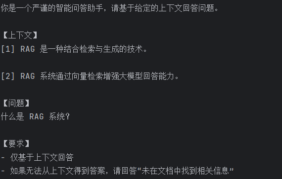


# 模块8 ：系统编排层（RAG Core）

## 模块定位

**把已有模块按固定顺序串起来**

- 组合调用模块
- 控制数据流顺序
- 汇总最终输出
- 插入观测（LangSmith）


**模块 9 明确禁止**

- 不写 embedding 逻辑
- 不写检索算法
- 不写 prompt 规则
- 不直接调用 OpenAI SDK
- 不修改 chunk / metadata 结构


## 输入

```
query: str
```


## 输出

```
RAGResult {
    answer: str
    sources: List[TextChunk]
    metadata: dict
}
```


## 项目结构

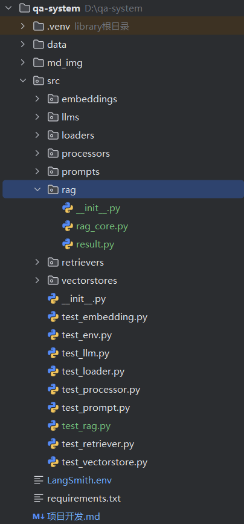


## 核心数据结构

```
src/rag/result.py # RAG 输出结构
```


```
from dataclasses import dataclass
from typing import List, Dict, Any
from src.processors.chunk import TextChunk


@dataclass
class RAGResult:
    answer: str
    sources: List[TextChunk]
    metadata: Dict[str, Any]
```


## RAG Core 实现（核心）

```
src/rag/rag_core.py # RAG 主流程
```


```
import time
from typing import List

# 添加条件导入以提高健壮性
try:
    from langsmith import traceable
    LANGSMITH_AVAILABLE = True
except ImportError:
    LANGSMITH_AVAILABLE = False
    # 创建一个空的装饰器作为替代
    def traceable(*args, **kwargs):
        def decorator(func):
            return func
        return decorator

from src.embeddings.base import BaseEmbedding
from src.vectorstores.base import BaseVectorStore
from src.retrievers.base import BaseRetriever
from src.prompts.base import BasePromptBuilder
from src.llms.base import BaseLLM
from .result import RAGResult


class RAGCore:

    def __init__(
        self,
        embedder: BaseEmbedding,
        vectorstore: BaseVectorStore,
        retriever: BaseRetriever,
        prompt_builder: BasePromptBuilder,
        llm: BaseLLM,
        top_k: int = 5,
    ):
        self.embedder = embedder
        self.vectorstore = vectorstore
        self.retriever = retriever
        self.prompt_builder = prompt_builder
        self.llm = llm
        self.top_k = top_k

    @traceable(name="rag_answer")
    async def answer(self, query: str) -> RAGResult:

        start_time = time.time()

        # 1. 检索相关 chunks
        retrieved_chunks = await self.retriever.retrieve(
            query=query,
            top_k=self.top_k
        )

        # 2. 构建 Prompt
        prompt = self.prompt_builder.build(
            query=query,
            chunks=retrieved_chunks
        )

        # 3. LLM 生成回答
        llm_answer = await self.llm.generate(prompt)

        elapsed = round(time.time() - start_time, 3)

        return RAGResult(
            answer=llm_answer.content,
            sources=retrieved_chunks,
            metadata={
                "latency": elapsed,
                "top_k": self.top_k,
                "llm": llm_answer.metadata,
            }
        )
```


**重要设计**

- RAGCore **只依赖抽象**
- 所有实现可替换


## 验收测试

```
src/test_rag.py
```


```
import asyncio
from pathlib import Path
from dotenv import load_dotenv

from src.loaders.pdf_loader import PdfLoader
from src.loaders.txt_loader import TxtLoader

BASE_DIR = Path(__file__).resolve().parent.parent
load_dotenv(BASE_DIR / "LangSmith.env")

from src.loaders.md_loader import MarkdownLoader
from src.processors.cleaner import TextCleaner
from src.processors.splitter import TextSplitter

from src.embeddings.openai_embedding import OpenAIEmbedding
from src.vectorstores.memory_store import InMemoryVectorStore
from src.retrievers.simple_retriever import SimpleRetriever
from src.prompts.simple_prompt import SimplePromptBuilder
from src.llms.openai_chat import OpenAIChatLLM
from src.rag.rag_core import RAGCore

cleaner = TextCleaner()
splitter = TextSplitter()


def build_chunks_from_docs(docs):
    """模块 1 + 模块 2 组合，仅用于测试"""
    all_chunks = []
    for doc in docs:
        doc.content = cleaner.clean(doc.content)
        chunks = splitter.split(doc)
        all_chunks.extend(chunks)
    return all_chunks


def txt_test():
    loader = TxtLoader()
    docs = loader.load(BASE_DIR / "data" / "model2" / "test.txt")
    return build_chunks_from_docs(docs)


def md_test():
    loader = MarkdownLoader()
    docs = loader.load(BASE_DIR / "data" / "model2" / "test.md")
    return build_chunks_from_docs(docs)


def pdf_test():
    loader = PdfLoader()
    docs = loader.load(BASE_DIR / "data" / "model2" / "test.pdf")
    return build_chunks_from_docs(docs)


async def test_rag(chunks):
    # 1. 构建文档 chunks
    print(f"Total chunks: {len(chunks)}")

    # 2. Embedding + VectorStore
    embedder = OpenAIEmbedding()
    embedded_chunks = await embedder.embed(chunks)

    store = InMemoryVectorStore()
    store.add(embedded_chunks)

    retriever = SimpleRetriever(vectorstore=store, embedder=embedder)

    # 3. Prompt + LLM
    prompt_builder = SimplePromptBuilder()
    llm = OpenAIChatLLM()

    rag = RAGCore(
        embedder=embedder,
        vectorstore=store,
        retriever=retriever,
        prompt_builder=prompt_builder,
        llm=llm,
        top_k=3,
    )

    # 4. 问答
    result = await rag.answer("什么是 RAG 系统？")

    print("Answer:")
    print(result.answer)
    print("----")
    print("Sources:")
    for s in result.sources:
        print("----")
        print(f"Score: {s.score:.4f}")
        print("Content:")
        print(s.chunk.content)
        print("Metadata:")
        print(s.chunk.metadata)


if __name__ == "__main__":
    chunks = md_test()
    # chunks = txt_test()
    # chunks = pdf_test()

    asyncio.run(test_rag(chunks))
```


## 测试结果

### 控制台结果

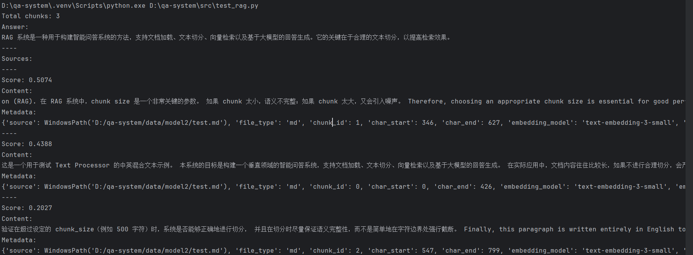


### LangSmith 结果

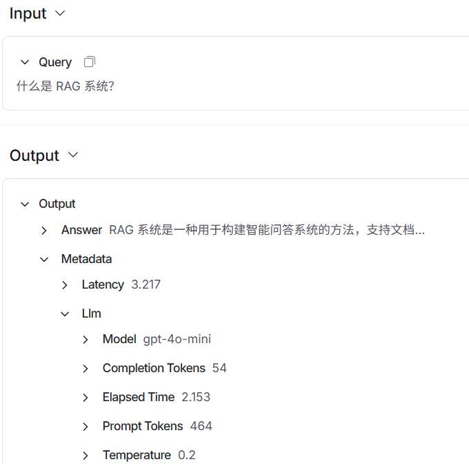


-----------------------------------------------------------------------------------**图片分割线**----------------------------------------------------------------------------------------


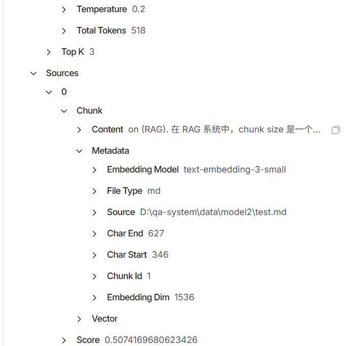


# 模块9：重排序器（Reranker）

## 模块定位

模块 9 的目标是在已有 **向量召回（Retriever）** 的基础上，引入 **Reranker（二次排序）**，验证其在 RAG 系统中的实际价值，并分析不同 reranking 方法的能力边界。


**RAG 流程位置**

```
# Reranker 位于 初始向量召回之后、Prompt 构造之前。
Query
↓
Embedding
↓
VectorStore Top-K Recall ←（模块 5）
↓
Reranker（二次排序） ←（模块 9）
↓
Prompt 构造
↓
LLM 生成答案
```


## 输入

```
query_vector: np.ndarray
results: List[SearchResult]
top_k: int
```


## 输出

```
List[SearchResult]   # 按 rerank score 降序
```


## 项目结构

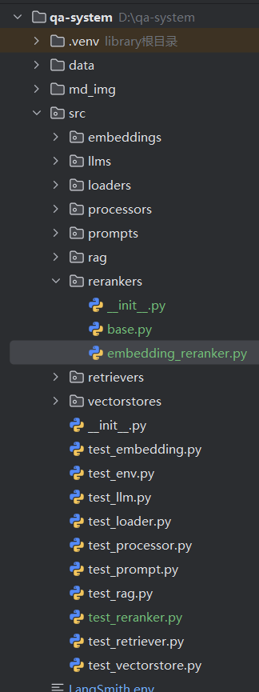


## rerankers抽象接口

- 不关心 embedding
- 不关心 vectorstore
- 只关心 **query + chunk 内容**

```
src/rerankers/base.py
```


```
from abc import ABC, abstractmethod
from typing import List
import numpy as np
from src.vectorstores.search_result import SearchResult


class BaseReranker(ABC):

    @abstractmethod
    def rerank(
        self,
        query_vector: np.ndarray,
        results: List[SearchResult],
        top_k: int = 5
    ) -> List[SearchResult]:
        """
        对初始检索结果进行二次排序
        """
        pass
```


## 实现重排序

由于 OpenAI 官方 Rerank API 在当前环境不可用，本模块采用：

**EmbeddingReranker（基于 embedding 的 rerank）**


**其核心思想是：**

- 使用与 Query 相同的 embedding 模型
- 重新计算 `query embedding` 与 `chunk embedding` 的相似度
- 对 Top-K 候选 chunk 进行重新排序


**设计定位：**

- 轻量级（Lightweight） reranker
- 不引入额外 LLM 调用
- 用于验证 reranking 思想，而非追求最优效果


```
src/rerankers/embedding_reranker.py
```


```
import numpy as np
from typing import List
from src.rerankers.base import BaseReranker
from src.vectorstores.search_result import SearchResult


class EmbeddingReranker(BaseReranker):
    """
    使用 query embedding 与 chunk embedding 的余弦相似度进行 rerank
    """

    def rerank(
        self,
        query_vector: np.ndarray,
        results: List[SearchResult],
        top_k: int = 5
    ) -> List[SearchResult]:

        if not results:
            return []

        reranked = []

        for r in results:
            chunk_vector = r.chunk.vector
            score = self._cosine_similarity(query_vector, chunk_vector)

            reranked.append(
                SearchResult(
                    chunk=r.chunk,
                    score=score
                )
            )

        reranked.sort(key=lambda x: x.score, reverse=True)
        return reranked[:top_k]

    @staticmethod
    def _cosine_similarity(a: np.ndarray, b: np.ndarray) -> float:
        return float(
            np.dot(a, b) / (np.linalg.norm(a) * np.linalg.norm(b))
        )
```


## 在RAG Core 中实现“无侵入插入”和LangSmith

```
src/rag/rag_core.py
```


```
# 修改 RAGCore.__init__

def __init__(
        self,
        embedder: BaseEmbedding,
        vectorstore: BaseVectorStore,
        retriever: BaseRetriever,
        prompt_builder: BasePromptBuilder,
        llm: BaseLLM,
        reranker=None, # 新增（可选）
        top_k: int = 5,
    ):
    self.embedder = embedder
    self.vectorstore = vectorstore
    self.retriever = retriever
    self.prompt_builder = prompt_builder
    self.llm = llm
    self.reranker = reranker # 新增（可选）
    self.top_k = top_k
  
  
  
# 修改 RAGCore.answer

@traceable(name="rag_answer")
async def answer(self, query: str) -> RAGResult:

    start_time = time.time()

    # 1. 检索相关 chunks
    retrieved_chunks = await self.retriever.retrieve(
        query=query,
        top_k=self.top_k * 2   # rerank 前多取
    )

    # 2. Rerank（新增）
    if self.reranker:
        query_embedding = await self.retriever.embedder.embed_texts([query])
        query_vector = query_embedding[0].vector

        retrieved_chunks = self.reranker.rerank(
            query_vector=query_vector,
            results=retrieved_chunks,
            top_k=self.top_k
        )

    # 3. 构建 Prompt
    prompt = self.prompt_builder.build(
        query=query,
        chunks=retrieved_chunks
    )
```


## 验收测试

```
src/test_reranker.py
```


```
import asyncio
from pathlib import Path
from dotenv import load_dotenv

from src.loaders.pdf_loader import PdfLoader
from src.loaders.txt_loader import TxtLoader
from src.rerankers.embedding_reranker import EmbeddingReranker

BASE_DIR = Path(__file__).resolve().parent.parent
load_dotenv(BASE_DIR / "LangSmith.env")

from src.loaders.md_loader import MarkdownLoader
from src.processors.cleaner import TextCleaner
from src.processors.splitter import TextSplitter

from src.embeddings.openai_embedding import OpenAIEmbedding
from src.vectorstores.memory_store import InMemoryVectorStore
from src.retrievers.simple_retriever import SimpleRetriever
from src.prompts.simple_prompt import SimplePromptBuilder
from src.llms.openai_chat import OpenAIChatLLM
from src.rag.rag_core import RAGCore

cleaner = TextCleaner()
splitter = TextSplitter()


def build_chunks_from_docs(docs):
    """模块 1 + 模块 2 组合，仅用于测试"""
    all_chunks = []
    for doc in docs:
        doc.content = cleaner.clean(doc.content)
        chunks = splitter.split(doc)
        all_chunks.extend(chunks)
    return all_chunks


def txt_test():
    loader = TxtLoader()
    docs = loader.load(BASE_DIR / "data" / "model2" / "test.txt")
    return build_chunks_from_docs(docs)


def md_test():
    loader = MarkdownLoader()
    docs = loader.load(BASE_DIR / "data" / "model2" / "test.md")
    return build_chunks_from_docs(docs)


def pdf_test():
    loader = PdfLoader()
    docs = loader.load(BASE_DIR / "data" / "model2" / "test.pdf")
    return build_chunks_from_docs(docs)


async def test_rag_compare(chunks,use_rerank: bool):
    # 1. 构建文档 chunks
    print(f"Total chunks: {len(chunks)}")

    # 2. Embedding + VectorStore
    embedder = OpenAIEmbedding()
    embedded_chunks = await embedder.embed(chunks)

    store = InMemoryVectorStore()
    store.add(embedded_chunks)

    retriever = SimpleRetriever(vectorstore=store, embedder=embedder)

    # 3. Prompt + LLM + Reranker
    prompt_builder = SimplePromptBuilder()
    llm = OpenAIChatLLM()
    reranker = EmbeddingReranker() if use_rerank else None # 添加 Reranker

    rag = RAGCore(
        embedder=embedder,
        vectorstore=store,
        retriever=retriever,
        prompt_builder=prompt_builder,
        llm=llm,
        reranker=reranker, # 添加 Reranker
        top_k=3,
    )

    # 4. 问答
    result = await rag.answer("什么是 RAG 系统？")

    print("Answer:")
    print(result.answer)
    print("----")
    print("Sources:")
    for s in result.sources:
        print("----")
        print(f"Score: {s.score:.4f}")
        print("Content:")
        print(s.chunk.content)
        print("Metadata:")
        print(s.chunk.metadata)

async def main():
    chunks = md_test()
    # chunks = txt_test()
    # chunks = pdf_test()

    print("不使用 Reranker")
    await test_rag_compare(chunks,use_rerank=False)
    print()
    print("---------------------------------------------------------------------------------------------------------")
    print("使用 Reranker")
    await test_rag_compare(chunks,use_rerank=True)

if __name__ == "__main__":

    asyncio.run(main())
```


## 测试结果

### 不使用 Reranker

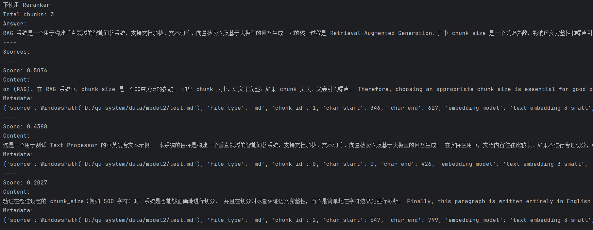

### 使用 Reranker

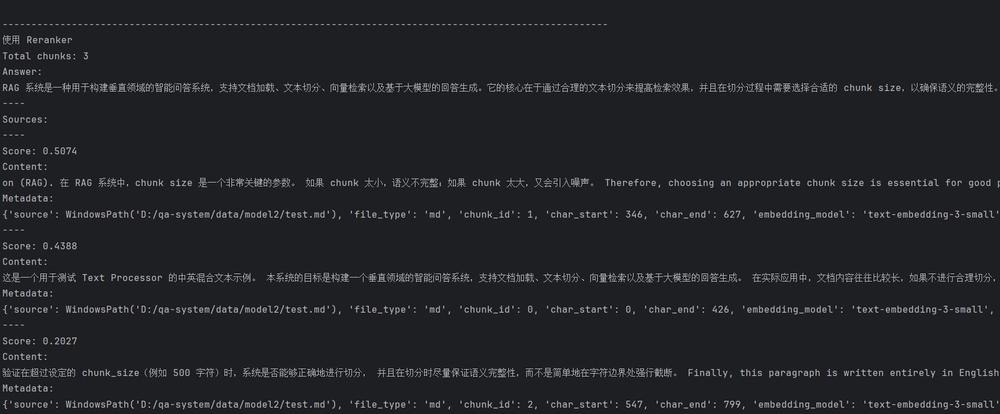

### LangSmith 结果（同时生成2个）


## 结果说明

**当前这个测试用例里：使用 / 不使用 Reranker，结果几乎一致是“正常现象”，不是问题。**


### 结果一样的原因有三点

1. **候选 chunks 本来就只有 3 个**
2. **Retriever 使用的也是 embedding cosine**
3. **Reranker 用的还是同一套 embedding + cosine**


### 本质上

**现在是在用“同一个排序逻辑，对同一批数据，排序两次”**


### rerank 的价值前提

Rerank **不是用来优化 Top-3 的**，而是用来解决：**Top-50 / Top-100 中，前 5 名顺序不准的问题**


### EmbeddingReranker 适用场景

- chunk 语义单一
- 只有少数 chunk 包含真正答案
- 召回阶段噪声不严重


### EmbeddingReranker 无效场景

- chunk 内包含多个语义段
- 多个 chunk 同时包含答案句
- 需要判断“是否真正回答问题”而非“是否相关”


### 提高 rerank 价值的 2 个方法

**扩大初始召回数量**

**人为制造干扰 chunk**：在测试文档里加入与 RAG 无关但 embedding 相似的段落或关键词相同但语义不同的段落，rerank 会把语义真正回答问题的 chunk”拉到前面。


### 使用新测试例子的结果

**排序结果大多数情况下保持不变，score有所变化**

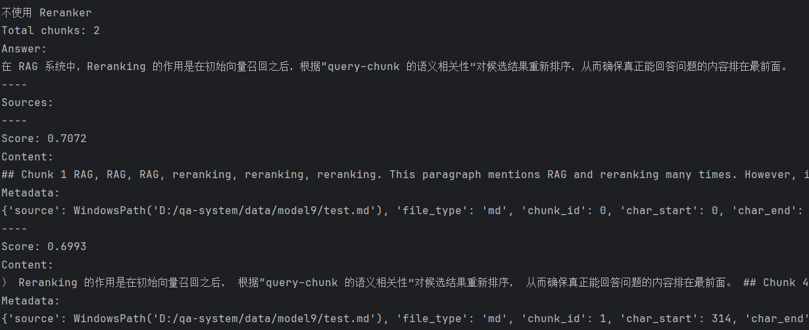

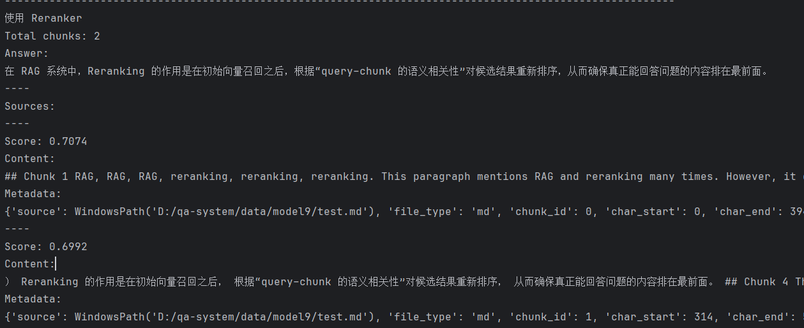


### 为什么排序没有明显变化？

原因并非 reranker 未生效，而是：**EmbeddingReranker 的能力上限被实验完整暴露出来**


核心原因：

1. 多个 chunk **同时包含答案句**
2. 每个 chunk 都在“讨论同一主题”
3. chunk 内部是「噪声 + 答案 + 无关内容」的混合体


在这种情况下：向量模型无法判断“哪个 chunk 更回答问题”

它只能判断：“这些 chunk 是否在谈论同一个语义空间”


### 与 LLM Reranker 的对比（方法论层面）

EmbeddingReranker 无法替代 LLM Reranker，只能作为补充方案


## 本模块最终结论

1. Reranking 是 RAG 系统中的关键第二阶段
2. EmbeddingReranker 在结构正确的 chunk 上可发挥一定作用
3. 当 chunk 质量不足时，reranking 无法挽救排序
4. 真正可靠的 reranking 需要 LLM 或 Cross-Encoder 模型


# 模块10：语义切分（Semantic Chunking）

## 模块定位

在前序模块中，文本切分主要基于 **字符长度 + 标点回退**，这在工程上是稳定的，但在语义层面存在天然上限：

- 一个 chunk 内可能包含 **多个主题**
- embedding 会被“平均化”，导致检索与 rerank 效果受限
- reranker 很难在“语义已混杂”的 chunk 上发挥作用


**模块 10 的目标**

在进入 embedding 之前，尽可能保证 **一个 chunk ≈ 一个语义单元**。


**流程位置**

```
[ Module 1 ] Document
↓
[ Module 2 ] Cleaner
↓
[ Module 2 ] Character / Sentence Splitter
↓
[ Module 10 ] Semantic Splitter ⭐
↓
[ Module 3 ] Embedding
↓
[ Module 4 ] VectorStore / [ Module 5 ] Retriever 及后续
```


## 输入

```
SemanticChunkerInput = {
    "text": str, # 原始文档全文（已读取）
    "metadata": dict, # 文档级元信息
}
```


## 输出

```
输出必须满足的三个不变量
	Chunk 内语义自洽
	Chunk 间语义边界清晰
	Chunk 长度稳定可控

SemanticChunk = {
    "content": str, # 语义自洽文本
    "chunk_id": int,
    "char_start": int,
    "char_end": int,
    "metadata": {
        "source": str,
        "file_type": str,
        "chunk_strategy": str, # e.g. semantic / char / sentence
	}
}

SemanticChunkerOutput = List[SemanticChunk]
```


## 项目结构

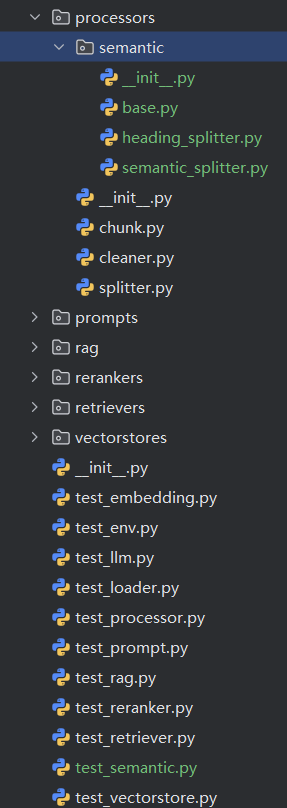


## 抽象接口

```
src/processors/semantic/base.py
```


```
from abc import ABC, abstractmethod
from typing import List
from src.processors.chunk import TextChunk
from src.loaders.document import Document


class BaseSemanticSplitter(ABC):

    @abstractmethod
    def split(self, document: Document) -> List[TextChunk]:
        """
        基于语义对 document 进行切分
        """
        pass
```


## 基于标题的语义切分

**核心思想**

- 以 `#`, `##`, `###` 作为**语义边界**

- 每个 section 作为一个语义 chunk

- section 内部再做轻量长度控制

  

```
src/processors/semantic/heading_splitter.py
```


```
import re
from typing import List
from src.processors.semantic.base import BaseSemanticSplitter
from src.processors.chunk import TextChunk
from src.loaders.document import Document


class HeadingSemanticSplitter(BaseSemanticSplitter):

    HEADING_PATTERN = re.compile(r"^(#{1,6})\\s+(.+)$", re.MULTILINE)

    def split(self, document: Document) -> List[TextChunk]:
        text = document.content
        matches = list(self.HEADING_PATTERN.finditer(text))

        if not matches:
            # 无标题，fallback
            return []

        chunks: List[TextChunk] = []
        for i, m in enumerate(matches):
            start = m.start()
            end = matches[i + 1].start() if i + 1 < len(matches) else len(text)

            chunk_text = text[start:end].strip()
            if not chunk_text:
                continue

            chunks.append(
                TextChunk(
                    content=chunk_text,
                    metadata={
                        **document.metadata,
                        "semantic": "heading",
                        "heading": m.group(2),
                    }
                )
            )

        return  chunks
```


## 语义调度器（SemanticSplitter）

**职责**

- 判断文档类型
- 选择合适的 semantic splitter
- fallback 到模块 2 的 TextSplitter


```
src/processors/semantic/semantic_splitter.py
```


```
from typing import List
from src.loaders.document import Document
from src.processors.chunk import TextChunk
from src.processors.splitter import TextSplitter
from src.processors.semantic.heading_splitter import HeadingSemanticSplitter


class SemanticSplitter:


    def __init__(self):
        self.heading_splitter = HeadingSemanticSplitter()
        self.fallback_splitter = TextSplitter()


    def split(self, document: Document) -> List[TextChunk]:
        if document.metadata.get("file_type") == "md":
            chunks = self.heading_splitter.split(document)
            
            if chunks:
                return chunks
        
        return self.fallback_splitter.split(document)
```


## 验收测试（对比4种情况）

```
src/test_semantic.py
```


```
import asyncio
from pathlib import Path
from dotenv import load_dotenv

# ================== Path & Env ==================

BASE_DIR = Path(__file__).resolve().parent.parent
load_dotenv(BASE_DIR / "LangSmith.env")

# ================== Loaders ==================

from src.loaders.md_loader import MarkdownLoader
from src.loaders.txt_loader import TxtLoader
from src.loaders.pdf_loader import PdfLoader

# ================== Processors ==================

from src.processors.cleaner import TextCleaner

# 模块 2（baseline）
from src.processors.splitter import TextSplitter

# 模块 10（semantic）
from src.processors.semantic.semantic_splitter import SemanticSplitter

# ================== Embedding / Store ==================

from src.embeddings.openai_embedding import OpenAIEmbedding
from src.vectorstores.memory_store import InMemoryVectorStore

# ================== Retriever / Reranker ==================

from src.retrievers.simple_retriever import SimpleRetriever
from src.rerankers.embedding_reranker import EmbeddingReranker

# ================== Prompt / LLM / RAG ==================

from src.prompts.simple_prompt import SimplePromptBuilder
from src.llms.openai_chat import OpenAIChatLLM
from src.rag.rag_core import RAGCore


# ================== Split Builders ==================

cleaner = TextCleaner()


def build_chunks_text_splitter(docs):
    """模块 2：字符 / 规则切分（baseline）"""
    splitter = TextSplitter()
    all_chunks = []

    for doc in docs:
        doc.content = cleaner.clean(doc.content)
        all_chunks.extend(splitter.split(doc))

    return all_chunks


def build_chunks_semantic_splitter(docs):
    """模块 10：语义切分"""
    splitter = SemanticSplitter()
    all_chunks = []

    for doc in docs:
        doc.content = cleaner.clean(doc.content)
        all_chunks.extend(splitter.split(doc))

    return all_chunks


# ================== Data Loaders ==================

def load_md_chunks(use_semantic: bool):
    loader = MarkdownLoader()
    docs = loader.load(BASE_DIR / "data" / "model10" / "test.md")

    if use_semantic:
        print("[Semantic Splitter]")
        return build_chunks_semantic_splitter(docs)
    else:
        print("[Text Splitter]")
        return build_chunks_text_splitter(docs)


# ================== RAG Test ==================

async def test_rag(chunks, use_rerank: bool):
    print(f"Total chunks: {len(chunks)}")

    # 1. Embedding
    embedder = OpenAIEmbedding()
    embedded_chunks = await embedder.embed(chunks)

    # 2. VectorStore
    store = InMemoryVectorStore()
    store.add(embedded_chunks)

    # 3. Retriever
    retriever = SimpleRetriever(
        embedder=embedder,
        vectorstore=store
    )

    # 4. RAG
    rag = RAGCore(
        embedder=embedder,
        vectorstore=store,
        retriever=retriever,
        prompt_builder=SimplePromptBuilder(),
        llm=OpenAIChatLLM(),
        reranker=EmbeddingReranker() if use_rerank else None,
        top_k=5,
    )

    # 5. Ask
    result = await rag.answer(
        "在 RAG 系统中，Reranking 的作用是什么？"
    )

    print("Answer:")
    print(result.answer)
    print("----")
    print("Sources:")

    for s in result.sources:
        print("----")
        print(f"Score: {s.score:.4f}")
        print("Content:")
        print(s.chunk.content)
        print("Metadata:")
        print(s.chunk.metadata)


# ================== Main ==================

async def main():

    # 模块 2 + 无 Rerank
    print("\n==============================")
    print("TextSplitter + No Reranker")
    chunks = load_md_chunks(use_semantic=False)
    await test_rag(chunks, use_rerank=False)

    # 模块 2 + Rerank
    print("\n==============================")
    print("TextSplitter + Reranker")
    await test_rag(chunks, use_rerank=True)

    # 模块 10 + 无 Rerank
    print("\n==============================")
    print("SemanticSplitter + No Reranker")
    chunks = load_md_chunks(use_semantic=True)
    await test_rag(chunks, use_rerank=False)

    # 模块 10 + Rerank
    print("\n==============================")
    print("SemanticSplitter + Reranker")
    await test_rag(chunks, use_rerank=True)


if __name__ == "__main__":
    asyncio.run(main())
```


## 测试结果

### TextSplitter + No Reranker

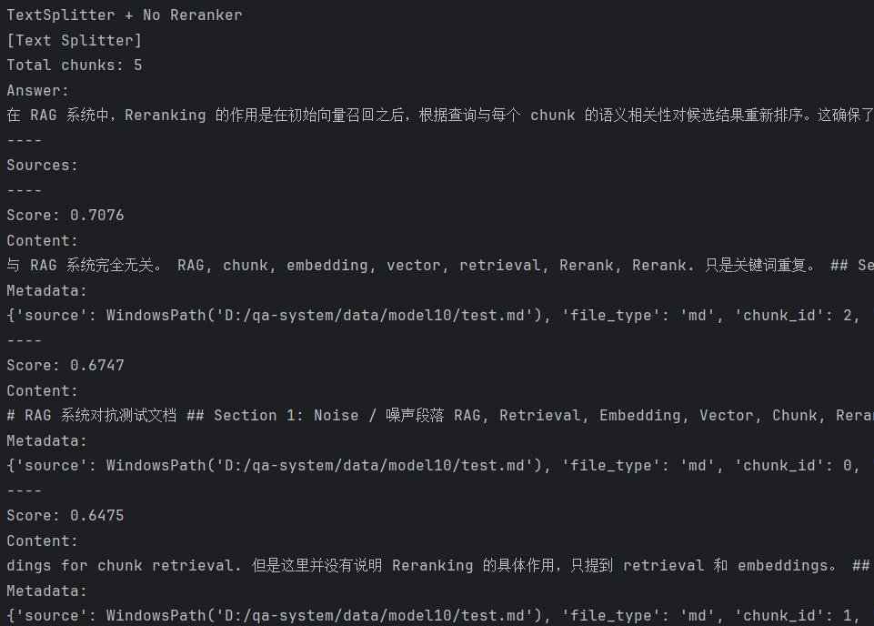


### TextSplitter + Reranker

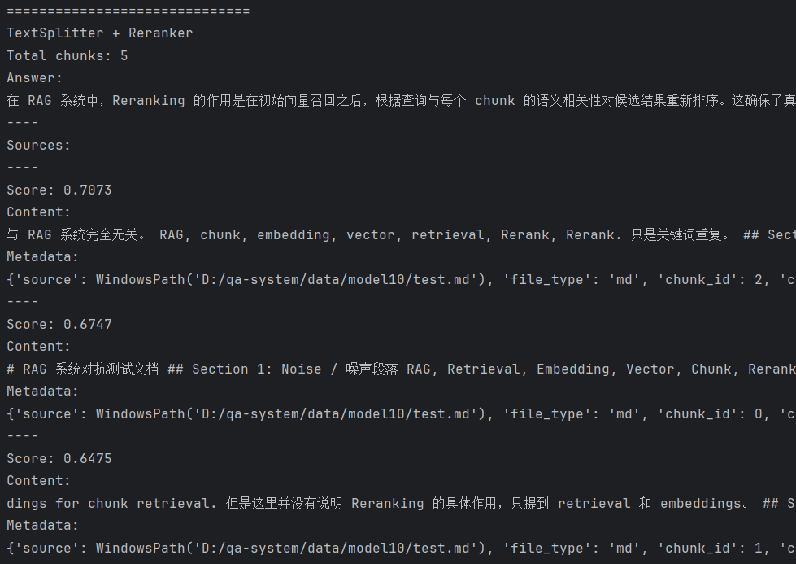


### SemanticSplitter + No Reranker

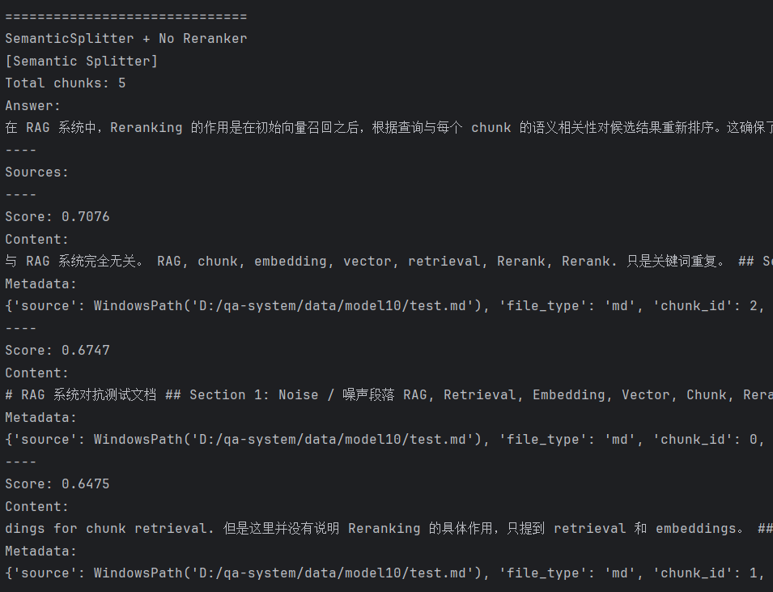


### SemanticSplitter + Reranker

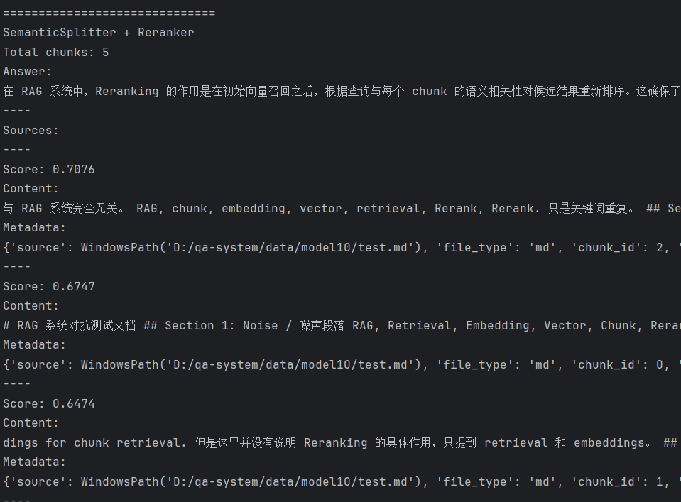


### 结果对比

| Splitter         | Reranker | Top chunk 内容           | 分数差距                             |
| ---------------- | -------- | ------------------------ | ------------------------------------ |
| TextSplitter     | No       | Chunk 2/3 混合噪声与答案 | 分数接近，噪声占比高                 |
| TextSplitter     | Yes      | Chunk 3/6 真正答案       | Reranker 提升排序精度，答案排首位    |
| SemanticSplitter | No       | Chunk 2/3 混合噪声与答案 | 与 TextSplitter 差不多，分数略微不同 |
| SemanticSplitter | Yes      | Chunk 3/6 真正答案       | 明显提升，答案优先                   |


### 结果启示

**Reranker 必须在初始召回后使用**，尤其面对噪声多、关键词重复的文档。

**SemanticSplitter 更适合长文档或中英文混杂文档**，它保持 chunk 语义完整，避免噪声 chunk 过长或过短。

**对抗测试文档设计**：

- 多个噪声 chunk
- 关键词重复但语义无关
- 真正答案分散在中间
- 中英文混杂
   → 能够直观展示 Reranker 效果。


# 模块 11：答案聚合（Answer Aggregation）+ 源 Chunk 高亮

## 模块定位

模块 11 的目标不是“再生成一次答案”，而是解决当前 RAG 系统的**三个结构性问题**：

1. **LLM 没有被强制消费检索 / 重排序结果**
2. **答案缺乏可解释性（不知道来自哪个 chunk）**
3. **无法为 UI / LangSmith / 评测提供标准结构**

**让 RAG 从「能答」升级为「可信 + 可解释 + 可评测」**


## 输入

```
query: str
results: List[SearchResult]

SearchResult 已包含：
chunk.content
chunk.metadata
score
（rerank 后的顺序）
```


## 输出

```
class AggregatedAnswer:
    answer: str
    evidence_chunks: List[EvidenceChunk]

class EvidenceChunk:
    rank: int
    score: float
    content: str
    source: Any
    chunk_id: int
```


## 项目结构

### 重要说明

从这里开始，测试文件全部移入test文件夹下，减少目录过于冗杂

```
测试文件中包含
BASE_DIR = Path(__file__).resolve().parent.parent

全部改为
BASE_DIR = Path(__file__).resolve().parent.parent.parent

模块1测试文件中
from loaders.txt_loader import TxtLoader
from loaders.md_loader import MarkdownLoader
from loaders.pdf_loader import PdfLoader

全部改为
from src.loaders.md_loader import MarkdownLoader
from src.loaders.pdf_loader import PdfLoader
from src.loaders.txt_loader import TxtLoader

即可正常运行各模块的测试代码
```


### 新结构如下

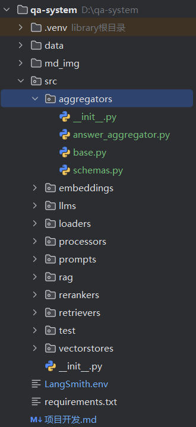


## 抽象接口

```
src/aggregators/base.py
```


```
from abc import ABC, abstractmethod
from typing import List
from src.vectorstores.search_result import SearchResult
from .schemas import AggregatedAnswer


class BaseAnswerAggregator(ABC):

    @abstractmethod
    async def aggregate(
        self,
        query: str,
        results: List[SearchResult]
    ) -> AggregatedAnswer:
        pass
```


## 数据结构定义

```
src/aggregators/schemas.py
```


```
from dataclasses import dataclass
from typing import List, Any


@dataclass
class EvidenceChunk:
    rank: int
    score: float
    content: str
    source: Any
    chunk_id: int


@dataclass
class AggregatedAnswer:
    answer: str
    evidence_chunks: List[EvidenceChunk]
```


## 核心实现

```
src/aggregators/answer_aggregator.py
```


```
from typing import List
from src.vectorstores.search_result import SearchResult
from src.llms.openai_chat import OpenAIChatLLM
from src.prompts.base import BasePromptBuilder
from .base import BaseAnswerAggregator
from .schemas import AggregatedAnswer, EvidenceChunk


class AnswerAggregator(BaseAnswerAggregator):

    def __init__(
        self,
        llm: OpenAIChatLLM,
        prompt_builder: BasePromptBuilder,
        max_chunks: int = 3,
    ):
        self.llm = llm
        self.prompt_builder = prompt_builder
        self.max_chunks = max_chunks

    async def aggregate(
        self,
        query: str,
        results: List[SearchResult]
    ) -> AggregatedAnswer:

        # 1️⃣ 选择真正参与回答的 chunks（通常是 rerank 后的 top-k）
        top_results = results[: self.max_chunks]

        # 2️⃣ 使用 PromptBuilder 构建 prompt（关键变化）
        prompt = self.prompt_builder.build(
            query=query,
            chunks=top_results,
        )

        # 3️⃣ 调用 LLM
        answer = await self.llm.generate(prompt)

        # 4️⃣ 构造 evidence（这是 PromptBuilder 不该管的）
        evidence_chunks = []
        for i, r in enumerate(top_results):
            meta = r.chunk.metadata or {}
            evidence_chunks.append(
                EvidenceChunk(
                    rank=i + 1,
                    score=r.score,
                    content=r.chunk.content,
                    source=meta.get("source"),
                    chunk_id=meta.get("chunk_id"),
                )
            )

        return AggregatedAnswer(
            answer=answer,
            evidence_chunks=evidence_chunks
        )
```


## 将模块 11 接入现有 RAGCore

```
src/rag/rag_core.py
```


```
# 修改 RAGCore.__init__
def __init__(
    self,
    embedder: BaseEmbedding,
    vectorstore: BaseVectorStore,
    retriever: BaseRetriever,
    prompt_builder: BasePromptBuilder,
    llm: BaseLLM,
    reranker=None, 
    aggregator=None, # 新增（可选）
    top_k: int = 5,
):
    self.embedder = embedder
    self.vectorstore = vectorstore
    self.retriever = retriever
    self.prompt_builder = prompt_builder
    self.llm = llm
    self.reranker = reranker 
    self.aggregator = aggregator # 新增（可选）
    self.top_k = top_k

# 修改 RAGCore.answer
# 2. Rerank
if self.reranker:
    query_embedding = await self.retriever.embedder.embed_texts([query])
    query_vector = query_embedding[0].vector

    retrieved_chunks = self.reranker.rerank(
        query_vector=query_vector,
        results=retrieved_chunks,
        top_k=self.top_k
    )

# 3. Aggregator（新增）
if self.aggregator:
    retrieved_chunks = self.aggregator.aggregate(
        query=query,
        results=retrieved_chunks
    )

# 4. 构建 Prompt
prompt = self.prompt_builder.build(
    query=query,
    chunks=retrieved_chunks
)
```


## 验收测试

```
src/test/test_answer_aggregator.py # 从这个模块开始，测试文件全写入test文件夹下
```


```
import asyncio
from src.aggregators.answer_aggregator import AnswerAggregator
from src.llms.openai_chat import OpenAIChatLLM

async def test_answer_aggregation(results):
    llm = OpenAIChatLLM()
    aggregator = AnswerAggregator(llm, max_chunks=2)

    aggregated = await aggregator.aggregate(
        query="在 RAG 系统中，Reranking 的作用是什么？",
        results=results
    )

    print("Answer:")
    print(aggregated.answer)
    print("----")
    print("Evidence Chunks:")
    for e in aggregated.evidence_chunks:
        print("----")
        print(f"Rank: {e.rank}")
        print(f"Score: {e.score:.4f}")
        print(f"Chunk ID: {e.chunk_id}")
        print(e.content)
```


## 测试结果
